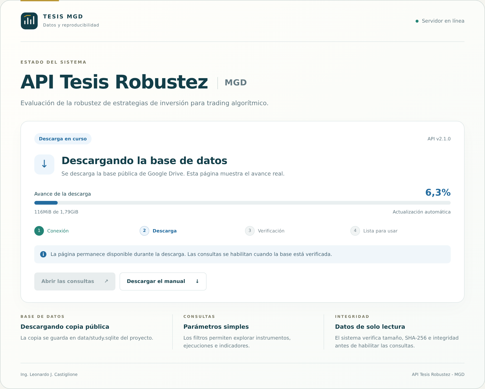

# API Tesis Robustez - MGD

Entrega **2.1.0** · API **2.1.0** · manual **v8**.

El proyecto permite consultar la base analítica por HTTP, repetir un caso con el
motor Python y comprobar los análisis en memoria. Incluye motor v9 y SQLite v2r3:
siete ETF, 189 configuraciones, 945 ejecuciones y 10.379.124 observaciones diarias.
Las consultas no modifican la base entregada.

## Inicio

Se necesitan Git, Docker con Compose y al menos 6GiB libres, además del espacio
de Docker. El repositorio es público y se clona sin iniciar sesión en GitHub:

```bash
git clone https://github.com/lcastiglione/api-tesis-mgd.git
cd api-tesis-mgd
docker compose up --build -d
docker compose logs -f api
```

El archivo `.env` ya está incluido en el repositorio y contiene el enlace público
de la base y el puerto 8000. Docker Compose lo lee automáticamente: no hace falta
copiarlo, editarlo ni configurar credenciales de Google. Al terminar la construcción
se puede abrir **http://localhost:8000/**: la página muestra el estado, los bytes
recibidos y el porcentaje real de descarga. Después muestra la verificación y,
cuando termina, **La API está lista para usar** y habilita el acceso a las consultas.



La esquina superior confirma la salud del servidor. La tarjeta central muestra el
progreso de descarga y la verificación de la base; **Disponible** confirma que ya
se pueden consultar los datos.

| Dirección | Uso |
|---|---|
| http://localhost:8000/ | Estado del servidor, descarga, verificación y acceso a las consultas. |
| http://localhost:8000/status | El mismo estado en JSON; funciona sin tener la base. |
| http://localhost:8000/docs | Probar consultas con botones y parámetros. |
| http://localhost:8000/health | Comprobar que la API puede abrir la base verificada. |
| http://localhost:8000/tutorials/api | Descargar el manual de la API. |

`Ctrl+C` termina la lectura de registros; `docker compose down` detiene el servicio.
La base se conserva en **`data/study.sqlite` dentro de la carpeta del proyecto**,
montada como `/data/study.sqlite` en el contenedor. No hace falta preparar carpetas
ni ajustar permisos: el servicio adapta su usuario al directorio y se ejecuta sin
privilegios. El puerto predeterminado es
**8000**.

Si el puerto 8000 del equipo donde corre Docker está ocupado, se puede iniciar
sin editar archivos con `API_PORT=18000 docker compose up --build -d` desde
Bash o WSL. En ese caso se abre http://localhost:18000/.

## Descarga automática de la base

La base se descarga desde [el archivo público de Google Drive](https://drive.google.com/file/d/16IpEVijsXvy_kTaYY7l2_zUHkxaDIr5g/view?usp=sharing).
El enlace está incluido en `.env` y en `data/manifest.json`.
El formato configurado es SQLite sin comprimir. La base y los archivos Excel
quedan fuera de GitHub y de la imagen Docker.

La descarga completa y el arranque de la API se verificaron sin credenciales.
El archivo conserva los 1.923.264.512 bytes y el SHA-256 del manifiesto, y SQLite
superó la comprobación de integridad. La evidencia está en
`docs/validation/public-download.json`.

El usuario solo ejecuta Docker: **no necesita cuenta de Google, OAuth, claves
de API, cookies del navegador ni configurar credenciales**. Docker instala las
dependencias.

En cada arranque se sigue este orden:

1. Si existe `data/study.sqlite` en el proyecto, se verifica y utiliza.
2. Si existe `data/study.sqlite.gz` en el proyecto, se verifica y expande.
3. Si faltan ambos, se descarga del enlace público a un archivo provisional. Se
   verifican tamaño, SHA-256 e integridad antes de instalar la copia definitiva.
   Si `download_format` indica `gzip`, también se verifica y expande el archivo.

Drive se invoca con `use_cookies=False`. Una descarga incorrecta se rechaza;
las huellas no se ajustan para aceptarla. Durante la preparación, la página inicial,
`/status`, `/docs` y el manual permanecen disponibles. Las consultas a datos y
`/health` responden **503** con `Retry-After` hasta que la base está verificada.
El control de Docker consulta `/status` para comprobar que el servidor web está
disponible durante la descarga; la preparación de los datos se consulta en `/health`.
`Application startup complete` confirma que el servidor web arrancó; el estado
**Disponible** de la página o `/health` con **200** confirman que la base está lista.

Si falla la descarga, el estado informa el problema y reintenta automáticamente.
Los registros conservan el detalle. El progreso mide los bytes recibidos, sin
inventar un porcentaje para la verificación.

### Probar la descarga otra vez

Se puede eliminar **solo `data/study.sqlite`** desde el equipo. El servicio detecta
su ausencia, suspende las consultas y vuelve a descargar y verificar la base.
No hace falta reiniciar el contenedor. La página inicial permite seguir todo el
proceso. Si queda un `data/study.sqlite.gz` válido, se utilizará esa copia local.

`data/manifest.json` y `data/README.md` se conservan. SQLite, gzip y los archivos
provisionales quedan excluidos mediante `.gitignore` y `.dockerignore`, por lo que no se
publican en GitHub ni se incorporan a la imagen Docker.

## Configuración incluida

El repositorio entrega este archivo `.env`, listo para usar:

```dotenv
DATABASE_URL=https://drive.google.com/file/d/16IpEVijsXvy_kTaYY7l2_zUHkxaDIr5g/view?usp=sharing
API_HOST=127.0.0.1
API_PORT=8000
```

`DATABASE_URL` indica la descarga pública y `API_PORT` establece el puerto 8000.
Docker adapta el usuario del contenedor al directorio de datos. Los arranques
siguientes reutilizan la base verificada.

## Consultas por parámetros

> **Advertencia:** la API recibe parámetros validados. Las consultas se definen
> en el servidor y los valores se envían por separado para prevenir inyecciones
> SQL. No se admite código SQL del cliente. Los campos adicionales se rechazan.

| Operación | Parámetros principales |
|---|---|
| `GET /api/v1/study` | Cantidades e identidad de la base. |
| `GET /api/v1/instruments` | Instrumentos y cantidades por instrumento. |
| `GET /api/v1/configuration-counts` | `instrument`, opcional; cuenta por familia. |
| `GET /api/v1/configurations` | `instrument`, `family`, `limit`, `offset`. |
| `GET /api/v1/executions` | `instrument`, `configuration`, `length`, `limit`, `offset`. |
| `GET /api/v1/executions/{execution_id}/indicators` | `segment`, `metric`, `limit`, `offset`. |
| `GET /api/v1/executions/{execution_id}/daily` | `segment`, `alternative`, `window_id`, `limit`, `offset`. |
| `GET /api/v1/executions/{execution_id}/operations` | `limit`, `offset`. |
| `POST /api/v1/verify-case` | JSON con `instrument`, `configuration` y `length`. |

En `/docs`, **Try it out** habilita la prueba y **Execute** envía la consulta.
Desde una terminal:

```bash
curl http://localhost:8000/health
curl "http://localhost:8000/api/v1/configuration-counts?instrument=SPY"
curl "http://localhost:8000/api/v1/executions?instrument=SPY&configuration=sma200&length=1&limit=1"
```

La última consulta devuelve un `execution_id` para consultar indicadores,
observaciones diarias y operaciones. `limit` admite hasta 1000 resultados;
`offset` permite recorrer páginas y `has_more` indica si quedan resultados.
`exact_value` conserva el decimal original y `numeric_value` permite aproximaciones.
`fraction` representa fracciones: `0.10` equivale a `10%`. Se consulta `status`
antes de interpretar una ausencia como cero.

## Uso del motor

```bash
curl -X POST http://localhost:8000/api/v1/verify-case \
  -H 'Content-Type: application/json' \
  -d '{"instrument":"SPY","configuration":"sma200","length":1}'
```

El motor repite ese caso en memoria y compara detalle diario, operaciones e
indicadores con la ejecución original. `passed` y `comparisons` muestran el
resultado. Se admite una comprobación simultánea y un proceso Uvicorn.

```bash
docker compose exec api python -m calculator.main --database /data/study.sqlite inspect
docker compose exec api python -m calculator.main --database /data/study.sqlite run-case \
  --instrument SPY --configuration sma200 --length 1 --execution-id comprobacion-spy
docker compose exec api python -m calculator.main --database /data/study.sqlite analyze
```

`validate` comprueba todos los bloques y puede demorar. `analyze` utiliza un
espacio temporal en memoria; no vuelve a simular los 945 casos ni cambia SQLite.

## Archivos y distribución

| Ruta | Contenido |
|---|---|
| `app/` | API, página de estado y descarga/verificación en segundo plano. |
| `calculator/` | Motor y análisis Python v9. |
| `data/` | Manifiesto y base descargada; SQLite y los provisionales quedan fuera de Git y de la imagen. |
| `docs/` | Manual API, ejemplos HTTP y evidencia. |
| `scripts/` | Registro de ejemplos y generación del manual. |
| `tests/` | Pruebas con base real y descarga simulada. |
| `release/` | Paquetes locales, excluidos de Git. |

El repositorio es https://github.com/lcastiglione/api-tesis-mgd. `.gitignore`
excluye SQLite, gzip, Excel, cachés y `release/`. `.env` se incluye con la
configuración pública preparada para el arranque.
`docs/source-provenance.json` conserva la procedencia del motor.

## Pruebas y regeneración del manual

```bash
docker build --target test -t api-tesis-mgd:test .
docker run --rm --volumes-from "$(docker compose ps -q api):ro" api-tesis-mgd:test
```

Las pruebas consultan la base real y reproducen un caso. Comprueban que la página
funciona durante la descarga, que los datos responden 503 hasta estar preparados,
que los errores se muestran y reintentan, y que borrar SQLite genera otra descarga.
Las pruebas de descarga
también comprueban la instalación atómica, el rechazo de archivos alterados y la
reutilización de la copia local, tanto para SQLite como para gzip.

En un entorno de desarrollo:

```bash
python3 -m pip install -r requirements-dev.txt
python3 scripts/record_api_examples.py --base-url http://localhost:8000
python3 scripts/build_tutorials.py
```

Los textos, la versión simple y los esquemas están en `docs/tutorial-content.json`.
El PDF se genera en `docs/api-tutorial-v8.pdf` y conserva el marco, la portada
ilustrada, consultas y respuestas con estilo, y el nombre del autor en cada pie.
No incluye fechas de edición ni fechas en sus metadatos.

Las palabras conservan espacio después del número: `176 sesiones`, `1 año`.
Los símbolos y abreviaturas de unidad se escriben junto al valor: `25%`,
`9.000USD`, `1,8GiB`.

Referencias técnicas: [descarga pública con gdown](https://github.com/wkentaro/gdown)
y [prevención de inyección SQL, OWASP](https://cheatsheetseries.owasp.org/cheatsheets/SQL_Injection_Prevention_Cheat_Sheet.html).
